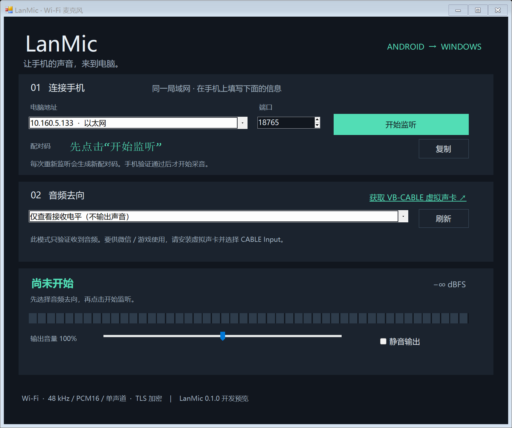

# 0.1.0 验证记录

交付日期：2026-10-14。此版本为开发预览，已验证构建、网络协议和 Windows 音频输出；尚未完成安卓真机端到端验收。

## 已完成

| 检查 | 结果 |
| --- | --- |
| Windows 构建 | 系统 C# 5 编译器成功生成 EXE；.NET Framework 4.7.2+，无第三方运行库依赖。 |
| Android 构建 | Temurin 21.0.12.1+1、Android API 35 r2 / Build Tools 35.0.0，javac 和 D8 成功；minSdk 26 / targetSdk 35。 |
| APK 安装元数据 | `io.lanmic.app`、版本 0.1.0、MainActivity 入口与麦克风前台服务声明已核对。 |
| APK 签名和对齐 | apksigner v2 / v3 验证通过，zipalign 通过。本地开发密钥签名。 |
| C# 真实 TLS 集成 | 21 项断言通过：配对、错误指纹/验证码拒绝、认证限速、分片读取、实际 PCM 电平、占用拒绝、异常帧、空闲超时、停止及重启等。 |
| 生产 Java 客户端 → C# 服务端 | 直接编译 App 内的 MicConnection，无网络模拟；11 项 Java 断言通过；C# 独立确认全部 27 帧 PCM 抵达且连接已释放。 |
| Windows 实际播放接口 | 以静音测试设备打开、缓冲完成、过载丢弃、清空和释放；3 次创建/停止循环通过。没有采集本机麦克风，没有改变默认设备。 |
| Windows 界面 | 实际窗口离屏渲染并检查，修复本机 175% DPI 下文字被裁切的问题。预览见下图。 |
| 构建脚本 | 在 Windows PowerShell 5.1、含中文与空格的项目路径中成功构建；下载工具保存在工作区内。 |

## 尚未验证 / 当前限制

- 没有连接安卓真机：实际麦克风录音、权限拒绝/恢复、锁屏持续采集、厂商省电策略、电话打断和快速启停尚待实测。桌面运行生产 Java 网络代码不能代替 Android 系统行为测试。
- 没有安装 VB-CABLE：未验证经虚拟声卡进入微信、会议或游戏软件的完整链路。当前 Windows 上的 WO Mic Device 不能直接复用其私有输入接口。
- 没有实测端到端延迟、长期音质或跨路由器稳定性。20 ms 是一帧的音频时长，不是延迟测量值。
- 播放队列上限 120 ms；当前没有自适应抖动缓冲或固定预填充。网络拥挤、丢包重传或到达间隔不均可能导致断续。
- Windows EXE 未进行商业代码签名；Android APK 使用本地开发签名，未上架应用商店。

## 真机验收步骤

1. 电脑启动监听，手机输入 IP、端口、完整配对码，允许麦克风与通知权限。
2. 先选耳机试听，确认手机说话时电平变化且电脑能收到声音；静音时没有声音，连接保持。
3. 安装 VB-CABLE 后，LanMic 输出选择 CABLE Input，目标应用输入选择 CABLE Output；录一段短音频核验音质。
4. 锁屏 5 分钟后确认仍有声音；必要时按手机厂商说明允许后台运行。
5. 从通知停止、连续开始/停止、断开 Wi-Fi 再连接；确认停止后麦克风指示消失，错误认证不会开始采音。
6. 在常用路由器与会议/游戏软件中进行持续测试，记录噪声、延迟、断续及电量。

运行自动检查：`powershell -NoProfile -ExecutionPolicy Bypass -File .\scripts\test.ps1`。
